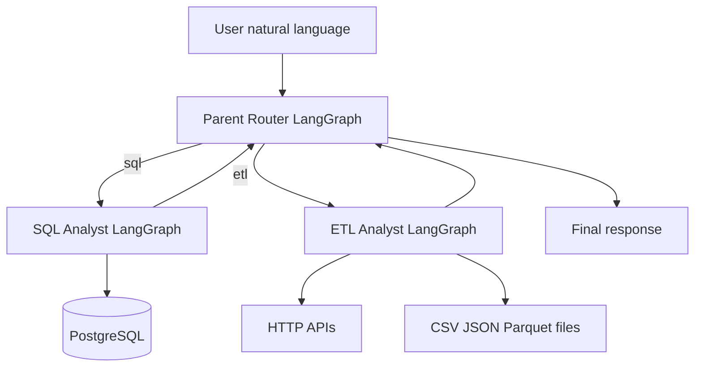
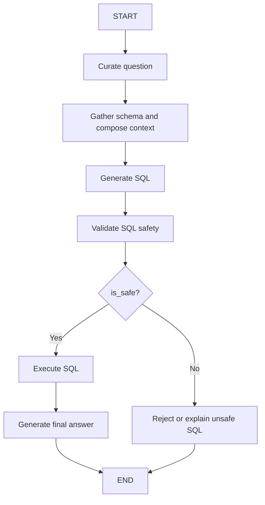
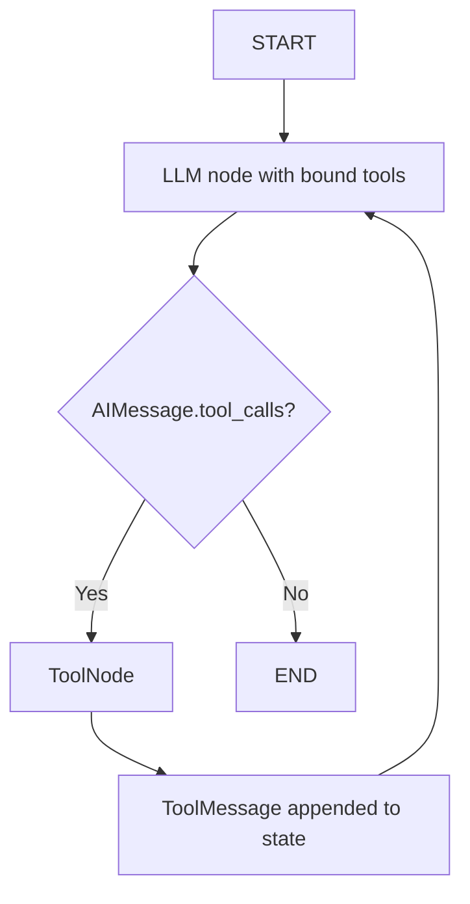
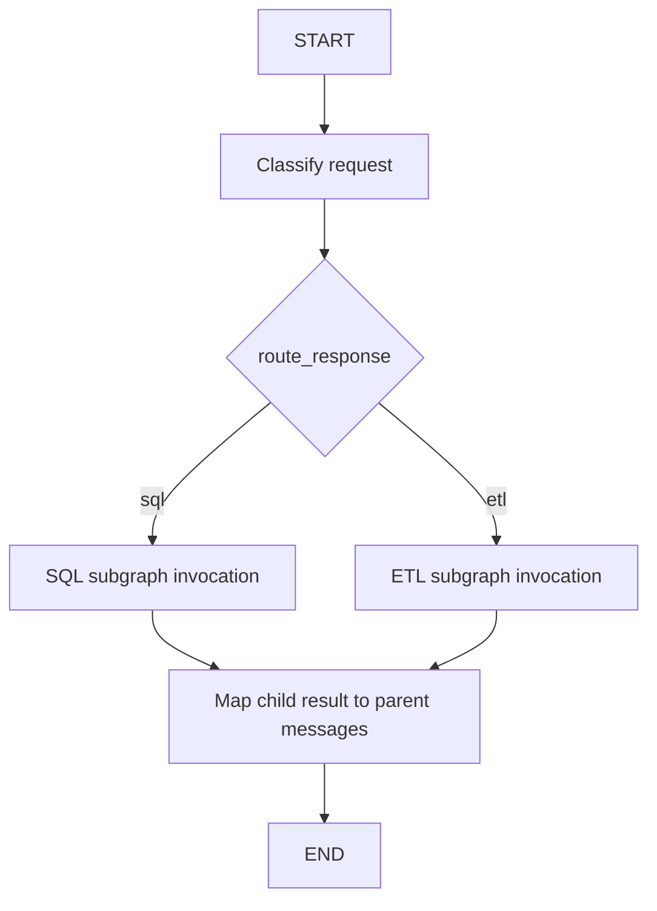

# AI Data Agent — Architecture and Implementation Blueprint

## Source fidelity
Based on the supplied ~5-hour transcript and the public repository README at https://github.com/anshlambagit/AI_Data_Agent . Individual repository source files could not be fetched. The graph design and names below are therefore an implementation-oriented reconstruction, not a line-by-line verified reproduction. Preserve the repository's source code when exact behaviour differs.

## Goal
Build three LangGraph agents: a SQL analyst, a tool-calling ETL analyst, and a parent router. The deliverable must remain accessible to junior engineers and specific enough for Cursor to implement without inventing architecture. No code in this document.

## System architecture

## Files and responsibilities
- `agents/data_agent.py`: parent router, conditional dispatch, child-agent invocation, result mapping.
- `agents/sql_analyst.py`: SQL graph, prompts, state mutations, SQL validation and result synthesis.
- `agents/etl_analyst.py`: tool-calling LLM, tool executor, message loop.
- `Models/schema.py`: Pydantic state and routing contracts.
- `utils/database.py`: PostgreSQL connections, schema introspection, SQL execution.
- `utils/etl_tools.py`: extraction and transformation tool definitions.
- `utils/llm_pick.py`: LLM model selection.
- `feed_db.py`: load example rides, ratings, payments, users, vehicles.
- `main.py`: entry point.

## Concepts and modules
| Concept | Mechanism | Why |
|---|---|---|
| State graph | `langgraph.graph.StateGraph` | deterministic node/edge workflow with shared state |
| Entry/exit | `START`, `END` | execution boundaries |
| Nodes | `add_node` | register named Python processing functions |
| Fixed transitions | `add_edge` | run next step unconditionally |
| Branches | `add_conditional_edges` | choose safe/unsafe SQL or tool/no-tool path |
| Compilation | `compile` | produce executable graph |
| Execution | graph `invoke` | run graph with input state |
| Tool execution | `langgraph.prebuilt.ToolNode` | execute requested ETL tools |
| Conversation | `HumanMessage`, `AIMessage`, `ToolMessage` | preserve requests, tool calls, tool results |
| Tool registration | `langchain_core.tools.tool` / `@tool` | machine-readable tool signature |
| Tool binding | chat model `bind_tools` | expose tool descriptions to model |
| Structured classification | `with_structured_output` | enforce route and safety schemas |
| Data contracts | Pydantic `BaseModel`, `Literal` | typed validated fields |
| Model execution | chat model `invoke` | generate classification, SQL or answer |
| PostgreSQL | `psycopg2` | schema inspection and read queries |
| ETL processing | `pandas` | normalization, filtering, serialization |

## SQL agent graph

### SQL state contract
- `messages: List`: conversation messages, input and/or accumulated outputs.
- `user_question: str`: unchanged original user intent.
- `curated_ques: str`: clearer restatement; must not add unsupported business constraints.
- `prompt_query_context: str`: curated question, schema metadata and SQL instructions.
- `generated_sql_query: str`: LLM-produced SQL statement.
- `is_safe: Literal['Yes','No']`: validation decision.
- `comments: str`: rationale for safety decision.
- `sql_query_execution_result: str`: serialised database result or failure information.
- `final_answer: str`: user-facing explanation grounded in query results.

### Node S1: Curate question
**Input:** `user_question`, recent relevant `messages`.
**Purpose:** resolve ambiguous phrasing without fabricating missing filters. **Operation:** build a prompt describing the user's original request; invoke the selected LLM; capture revised question as `curated_ques`. **AI concepts:** prompt engineering, LLM `invoke`, context management. **Output:** `curated_ques`. **Failure:** keep original question if refinement fails; never silently change the requested metric.

### Node S2: Schema context
**Input:** `curated_ques`; database configuration. **Purpose:** prevent model from inventing nonexistent tables and columns. **Operation:** `DatabaseUtil.schema_details('public')` retrieves accessible table/column metadata; assemble schema and instructions in `prompt_query_context`. **AI concepts:** context engineering and prompt grounding; this is not RAG unless retrieval/vector infrastructure is explicitly added. **Output:** `prompt_query_context`. **Failure:** stop with explicit database/schema error.

### Node S3: SQL generation
**Input:** schema context. **Purpose:** produce executable PostgreSQL read query. **Operation:** invoke selected LLM with PostgreSQL syntax rules, permitted tables, question, limit convention. Store exact SQL in `generated_sql_query`. **AI concepts:** text-to-SQL, `invoke`, instruction following. **Failure:** blank or malformed query must not execute.

### Node S4: Safety validation
**Input:** generated SQL. **Purpose:** separate generation from approval. **Operation:** run structured assessment and populate `is_safe`, `comments`; repository describes safety checks and Pydantic validation. **AI concepts:** LLM-as-judge, `with_structured_output`, Pydantic schema, deterministic conditional branching. **Important:** an LLM safety verdict alone is not a security control. For deployment, additionally parse SQL, enforce single read-only statement, least-privilege DB credentials, limits and timeouts. **Output:** Yes/No and comments.

### Node S5: Conditional decision
**Input:** `is_safe`. **Purpose:** avoid executing rejected SQL. **Operation:** LangGraph `add_conditional_edges` maps `Yes` to execution, `No` to a rejection response or optional regeneration loop. The README confirms safety gating, but exact rejection-loop wiring is unverified. **Output:** next node name.

### Node S6: Execute SQL
**Input:** approved SQL. **Purpose:** retrieve actual data rather than hallucinated results. **Operation:** `psycopg2` database execution through `DatabaseUtil`; fetch and serialize results into `sql_query_execution_result`. **AI concepts:** tool-like deterministic external action, not an LLM invocation. **Failure:** database exception captured and returned, never interpreted as a successful empty result.

### Node S7: Answer generation
**Input:** original/curated question, SQL, result. **Purpose:** explain data to user. **Operation:** prompt selected LLM to answer strictly from results; invoke and store `final_answer`. **AI concepts:** grounded generation and `invoke`. **Failure:** distinguish no rows from query failure; never fabricate numerical results.

## ETL agent graph

### ETL state
`ETLAgentSchema.messages: List`. For a real ReAct cycle, use message accumulation rather than overwriting old tool messages. Preserve tool call IDs, AI tool requests and corresponding ToolMessages.

### Node E1: Tool definitions and binding
**Purpose:** give the model a controlled action vocabulary. Define `extract_load_tool` and `transform_load_tool` with descriptive argument contracts and return structures. Use LangChain `@tool` and model `bind_tools` before invoking. Tool binding advertises actions; it does **not** execute them. **Output:** tool-enabled chat model.

### Node E2: LLM reasoning and action selection
**Input:** conversation messages and tool definitions. **Purpose:** determine whether to extract, transform or answer. **Operation:** invoke tool-bound model. If it returns an AIMessage with tool_calls, append the AIMessage; otherwise append final AIMessage. **Concepts:** ReAct, tool calling, `invoke`, message state.

### Node E3: Tool routing
**Input:** latest AIMessage. **Purpose:** choose loop or termination. **Operation:** conditional edge checks whether tool calls exist; branch to ToolNode or END. **Concepts:** `add_conditional_edges`, tool-call protocol.

### Node E4: ToolNode execution
**Input:** tool calls with names, arguments, IDs. **Purpose:** run external actions. **Operation:** dispatch to registered tools; record each return as a ToolMessage with matching call ID. **Concepts:** LangGraph `ToolNode`, tool results. **Failure:** tool exceptions should be represented as failed tool results, not fake success.

### Tool T1: extract_load_tool
**Input:** endpoint URL, target format, output location, relevant request parameters. **Purpose:** ingest API JSON into a tabular artifact. **Operation:** validate endpoint; HTTP request; check status; parse JSON; normalize nested records via Pandas; serialize CSV/JSON/Parquet; return output path, row count and status. The README confirms API extraction and these output formats; exact function arguments are unverified. **Security:** allowlist domains and output roots; block SSRF, file traversal and secret leakage.

### Tool T2: transform_load_tool
**Input:** input file, transformation instructions, target format/path. **Purpose:** transform data using Pandas. **Operation:** inspect schema; have LLM generate transformation logic; execute in controlled environment; validate resulting DataFrame; save file; return status and generated code summary. The README claims sandboxed execution but the actual isolation implementation is unverified. **Security:** never execute untrusted generated Python directly in the host process; use OS/container isolation and filesystem/network restrictions.

### Node E5: ReAct continuation
**Input:** ToolMessages. **Purpose:** let the LLM inspect tool outcomes and decide whether the task is finished. **Operation:** append tool feedback, return edge to LLM node, call `invoke` again. **Output:** either another tool request or a final answer. **Guardrail:** enforce iteration and tool-call limits.

## Parent router graph

### Router schemas
- `RouterSchema.answer: Literal['sql','etl']`
- `RouterSchema.comments: str`
- `DataAgentSchema.messages: List`
- `DataAgentSchema.route_response: str`

### Node R1: Classify
**Input:** latest user message and relevant conversation. **Purpose:** choose specialist. **Operation:** invoke a chat model with `with_structured_output(RouterSchema)`; write `answer` into `route_response`, preserve `comments` for diagnostic use. **AI concepts:** structured output, Pydantic, `invoke`, intent classification. **Failure:** invalid classification must raise a controlled error or request clarification, not default silently.

### Node R2: Dispatch
**Input:** `route_response`. **Purpose:** choose child. **Operation:** LangGraph `add_conditional_edges` maps `sql` and `etl` to distinct invocation nodes. **AI concepts:** conditional routing and multi-agent orchestration.

### Node R3: SQL child invocation
**Input:** parent messages. **Purpose:** execute SQL workflow. **Operation:** build child `AgentSchema` with the user question and required defaults; invoke compiled SQL graph; extract `final_answer`; append an AIMessage to parent messages. **AI concepts:** subgraph composition, graph `invoke`, state mapping.

### Node R4: ETL child invocation
**Input:** parent messages. **Purpose:** execute ETL workflow. **Operation:** build `ETLAgentSchema`, invoke compiled ETL graph, return its final AIMessage or tool result summary; append it to parent messages. **AI concepts:** subgraph invocation, message state, tool-calling orchestration.

## End-to-end scenarios
**SQL:** “Show the top five users with highest ratings” → router `sql` → curate question → load PostgreSQL schema → generate SELECT → validate → execute → summarize returned rows → parent answer.

**API extraction:** “Extract Pokémon API and save CSV” → router `etl` → bound LLM calls `extract_load_tool` → ToolNode requests endpoint, normalizes records and writes CSV → ToolMessage reports outcome → LLM summarizes saved file.

**File transformation:** “Filter rides.csv to ratings above 4.5 and save JSON” → router `etl` → bound LLM calls `transform_load_tool` → generate/execute Pandas logic → write JSON → tool result → final response.

## Cursor implementation order
1. Create Python environment, dependencies and environment variables.
2. Configure PostgreSQL and load the sample CSVs with `feed_db.py`.
3. Implement Pydantic schemas and verify validation/default behaviour.
4. Implement `DatabaseUtil` and schema inspection; test independently.
5. Implement `pick_llm` with supported model/provider configuration.
6. Implement SQL nodes individually; verify state updates and failure paths.
7. Wire and compile SQL graph; test safe and unsafe questions.
8. Implement ETL tool signatures and deterministic ETL operations.
9. Bind tools to model; implement ToolNode loop and message accumulation.
10. Compile ETL graph; test extraction, transformation, failed tool and multiple tool calls.
11. Implement router structured output and conditional dispatch.
12. Map child state/results into parent messages; compile parent graph.
13. Implement `main.py`, logging and end-to-end tests.
14. Add deployment controls: read-only DB role, SQL parser, HTTP egress controls, sandboxed Python execution, credential isolation, iteration budgets and observability.

## Acceptance criteria
- SQL requests route only to SQL child; ETL requests only to ETL child.
- Every node writes the documented fields, without losing original user intent.
- Schema grounding is based on the actual database.
- Unsafe SQL never reaches execution; PostgreSQL access is read-only.
- Successful SQL answers contain only observed result facts.
- ETL tools are called by tool-call ID and results are returned as ToolMessages.
- ETL graph continues after a tool call and terminates after a final AIMessage.
- Extract and transform tools produce valid requested formats and report their output paths.
- Invalid tool arguments, inaccessible APIs, invalid input files, query errors and malformed structured output produce explicit errors.
- Parent state retains a meaningful final answer.

## Exact-replication caveats
The public README documents components, states and high-level workflows, but not every precise function signature, prompt, transition, retry policy or actual isolation boundary. Do not claim parity with the original repository until `agents/*.py`, `Models/schema.py` and `utils/*.py` are compared line by line. In particular, whether prompt construction is a standalone graph node, the unsafe SQL branch loops, and exact ETL tool parameters require source-code inspection.